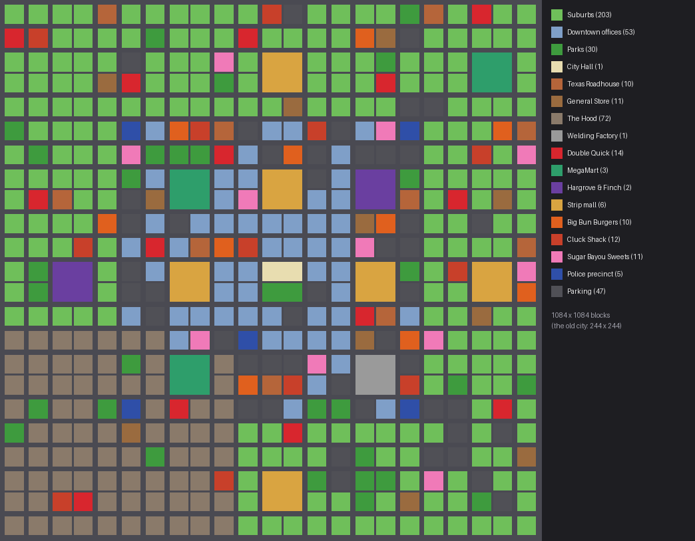

# Freerun — Mirror's Edge–style parkour for Minecraft (Fabric 1.21.1)

Wall runs, wall climbs, ledge grabs and shimmying, mantles, vaults, slides and landing rolls,
with animated arms in first person and full-body animation in third person (visible to other
players when the server has the mod too).

> **Status:** builds cleanly on GitHub Actions against Minecraft 1.21.1. Newer features
> (most recently office jobs, rentals, furniture, the arcade and the bar) haven't been play-tested yet, so expect
> some tuning.

## Build the .jar

**Option A — GitHub, no setup (works from a phone):**
1. Create a new GitHub repository and upload everything in this folder (keep the `.github` folder).
2. Open the **Actions** tab → the latest **build** run → download the **freerun-mod** artifact.
3. Unzip it and use `freerun-1.0.0.jar` (not the `-sources` one).

**Option B — on your PC:** install Java 21, then in this folder run `gradlew build`
(`./gradlew build` on Mac/Linux). The jar appears in `build/libs/`.

## Install

1. Install **Fabric Loader** for **Minecraft 1.21.1** with the installer from https://fabricmc.net/use/.
2. Put these in your `.minecraft/mods` folder:
   - `freerun-1.0.0.jar`
   - **Fabric API** for 1.21.1 (Modrinth or CurseForge)
3. Start the **fabric-loader-1.21.1** profile in the Minecraft launcher.

Multiplayer: the client mod works on its own, but other players only see your animations and
the roll/fall-damage protection only works if the **server** also has Freerun + Fabric API.

## Controls

Uses your normal keys — **Jump** is "up", **Sneak** is "down". Sprint first.

| Move | How |
|---|---|
| Vault | Sprint into a waist-high obstacle (or press Jump at it) |
| Wall climb | Sprint at a wall and Jump |
| Mantle | Automatic at the top of a wall climb |
| Ledge grab | Jump/fall at a ledge while holding Forward |
| Hang: climb up / drop / shimmy | Jump / Sneak / Left & Right |
| Hang: leap to another ledge | Left/Right + Jump sideways, Jump up (when you can't climb over), Sneak drops to the ledge below |
| Hang: leap across a gap | Back + Jump: turns you round onto a ledge or wall behind you (up to ~6 blocks, e.g. across an alley); with nothing there, a wall kick |
| Free climb | Jump or fall onto a **brick, stone-brick, cobblestone, wood, log or iron** wall holding Forward and you cling to it. W/S climb, A/D move sideways, Jump leaps (up, or with A/D/S sideways/backwards), Sneak lets go. Reach a ledge and you grab it; reach the top and you pull yourself over |
| Wall run | Jump alongside a wall while sprinting, hold Forward |
| Wall jump | Jump during a wall run (chain to the opposite wall) |
| Wall kick | Jump during a wall climb (turns 180°) |
| Slide | Sneak while sprinting; Jump out to keep speed |
| Landing roll | Tap Sneak while falling; absorbs ~12 blocks of fall damage |
| Toggle mod | **K** (rebind in Controls → Freerun) |
| Blackwire hack | **H** / **Shift+H** while holding your phone |
| Skill tree | **P** |
| Swampwatch | **G**: open the dial / use the creature's power · **Shift + G**: turn back |
| Second-person view | **F5** a fourth time (after first person, behind, in front): you, as seen by whoever's nearest and can see you |

**What can be climbed** is the block tag `freerun:climbable` (`data/freerun/tags/block/climbable.json`):
bricks, all the stone bricks, cobblestone, deepslate bricks/tiles, mud and nether bricks,
sandstone, polished andesite, quartz bricks and pillars, logs, planks, walls, fences, trapdoors,
iron bars, chains and copper grates. Glass, concrete and smooth stone can't be climbed. Change
the list with a datapack. Anything that sticks out with room for your hands on top (a window
sill, a cornice, an AC unit, a fire-escape landing) can be hung from, even if you can't stand on it.

### Parkour in the city

- **Office towers** have climbable stone columns every four blocks and a ledge running round the
  outside of every floor between the columns: climb a column, leap sideways onto a ledge, shimmy,
  leap to the next column, and so on up to the roof. Twin-tower blocks have a narrow beam from the
  lower roof across to a ledge on the taller tower.
- **Back alleys** run through the gaps between downtown and hood blocks: two climbable brick walls
  two blocks apart (wall-run along them, wall-jump between them, climb up and run along the tops),
  with dumpsters and crates to vault, AC units and fire-escape landings to hang from, drainpipes,
  clotheslines and a doorway halfway along each side.
- **Hood apartments** are brick all the way up, with two-block roof-to-roof gaps between them.

## Careers and skill trees

The first time you join a world you pick a career: **Employee**, **Supervisor**,
**Superintendent** or **Upper Management**. Press **P** any time to open your skill tree (or the
picker, if you haven't chosen). You can switch careers from the tree; your skills reset but your
level stays.

**Prestige:** once every skill in your current tree is unlocked, a **★ Get Promoted** button
appears (click it twice to confirm). You start the next career at level 1, and every skill you
already own keeps working. Finished careers show as ★ tabs in the tree (view only) and can't be
picked again. Finish all four and you're done.

**Levelling:** career XP comes from doing the job. Pressing a part +5, welding +8, cutting welds
+2, a crane lift +4 (setting it down +2), a forklift lift +4, making boudin +3, beating a hostile
mob +4 (a gangster +6), every 6 blocks mined +1, and +2 for every minute on the clock, +2 for a cup of coffee. Level N
needs 30 + 15×N XP to reach the next; the cap is level 20. Every level gives one skill point
(you start with one). A small readout in the top-left corner shows XP as you earn it.

**Trees:** thirteen skills per career in five tiers. Tiers open at levels **1, 3, 6, 9 and 12**
(so you reach the next tier much sooner than before), and each tier past the first needs a skill
from the tier before it. The capstone sits alone in tier 5.

| Career | Tier 1 (Lv 1) | Tier 2 (Lv 3) | Tier 3 (Lv 6) | Tier 4 (Lv 9) | Tier 5 (Lv 12) |
|---|---|---|---|---|---|
| Employee | Hard Worker (Mine 15% faster) · Steel-Toed Boots (+2 armor, and 25% less fall damage) · Union Card (Your paycheck is 20% bigger) | Forklift Certified (Forklifts drive 35% faster and their forks lift twice as fast for you) · Overtime (Earn double XP just for being on the clock) · Safety Glasses (Blindness and Darkness wear off instantly) | Packed Lunch (A fresh link of boudin turns up in your lunchbox every 8 minutes) · Strong Back (+2 hearts and 30% knockback resistance) · Second Wind (Below 4 hearts, you start regenerating) | Ride Share (Cars you drive have 20% more top speed and pick-up) · Coffee Run (A fresh Cup of Coffee turns up every 6 minutes) · Shop Floor Legend (+3 hearts) | Employee of the Month (Move 12% faster, mine another 15% faster, and earn 25% more XP) |
| Supervisor | Clipboard (+1 attack damage. Writing people up hits hard) · Safety First (40% less fall damage, and fall 2 blocks further before it hurts) · Open Door Policy (Shops give you 10% off) | Walking the Floor (Move 8% faster) · Write-Up (Your hits knock things much further back) · Loss Prevention (Stopping a crime pays double) | Eagle Eye (Permanent night vision. Nothing on the floor gets past you) · Sick and Tired (+2 more attack damage and 20% faster attacks) · Police Radio (You hear every crime reported anywhere in the city) | Chain of Command (+3 armor toughness) · Overtime Approved (Your paycheck is 25% bigger) · Quality Control (Stores pay you 15% more for what you sell) | Promotion Track (Earn 40% more XP, and players near you get Speed) |
| Superintendent | Site Walk (Move 10% faster) · Heavy Equipment (Overhead cranes drive 60% faster for you, and forklift forks lift twice as fast) · Hard Hat (+2 armor) | Long Reach (Reach blocks 2 further and entities 1 further) · Mining Operations (Mine 25% faster) · Site Radio (Blackwire hacks use 30% less battery) | Fire Watch (Permanent fire resistance) · Step Up (Walk straight up full blocks without jumping) · Road Crew (Cars you drive accelerate harder and turn tighter) | Utility Access (Hacking traffic lights and street lights costs no battery) · Scaffold Legs (Jump higher and fall 3 blocks further safely) · Zoning Commissioner (+$25 on every paycheck) | Shutdown Authority (Permanent Haste II and +2 hearts. The site runs on your say-so) |
| Upper Management | Expense Account (Collect 2 gold ingots every 10 minutes) · Corner Office (+2 hearts. The view is great for your health) · Company Card (Shops give you 15% off) | Synergy (+2 luck: better fishing and better loot) · Executive Presence (Permanent Hero of the Village: villagers give you discounts) · Insider Trading (Hacks that pay out cash pay 50% more) | Golden Parachute (Whenever you fall, you float gently down instead) · Quarterly Bonus (Earn 50% more XP, plus a diamond every 30 minutes) · Bodyguard Detail (The police never come after you) | Stock Options ($5 lands in your account every 2 minutes) · Private Security (Permanent Resistance) · Board Seat (Your paycheck is 40% bigger) | Hostile Takeover (+4 attack damage, +4 armor, and slow constant regeneration) |

P is also vanilla's Social Interactions key; the skill tree reads the key directly so it opens
either way. Rebind it under Controls → Freerun if you like.

## The city

Cities are now about **20 times bigger: 1,084 × 1,084 blocks**, an 18 × 18 grid of city blocks
(the old one was 244 × 244). Most 2,048-block regions of the overworld get one (and there's
almost always one within a couple of kilometres of spawn), on reasonably dry, reasonably flat land; hills are cut down, hollows and rivers filled in, and the edges sloped
off. Type **`/findcity`** to get the nearest one's location and direction, or **`/city`** (needs
cheats) to found one centred on you, at the height of the ground around you. A city that size is
built chunk by chunk as you explore (the part around you goes up within seconds). If a chunk of
a city ever comes out missing, it's filled in automatically the next time it loads.

No trees, grass, flowers or mushrooms generate in or right around a city any more (a tree growing
in the next chunk used to drop leaves, logs and dirt into a block already built). Cities from
before this fix are swept once, as each chunk loads: wild leaves, the trees they belong to, grass
and ferns (and stray dirt, in chunks nobody has spent time in). **`/cityclean [radius]`** (cheats)
sweeps the chunks around you right away, dirt included. Leaves, flowers and trees the city
placed itself, and anything you placed, are left alone.

- **Downtown:** office towers 5–10 floors tall around **City Hall** and the central park.
- **The commercial ring:** two **MegaMart Supercenters**, two **Hargrove & Finch** department
  stores, six strip malls, and plenty of **Big Bun Burgers**, **Cluck Shacks**, **Sugar Bayou
  Sweets**, Double Quicks, General Stores and Texas Roadhouses, with **parking lots** joined up by
  paved service lanes so you can drive from one lot to the next. Stores are spread out: you won't
  find two of the same restaurant or shop within about 230 blocks of each other.
- **The Hood** (south-west), with apartments, corner stores, community gardens, basketball courts
  and the odd vacant lot that's Rust Rat / Chrome King turf.
- **The welding factory** (south-east), ringed by parking.
- **Suburbs** everywhere else, with parks, corner stores and **five police precincts** spread
  through them.

### Stores

| Store | What it is | Sells |
|---|---|---|
| **MegaMart Supercenter** | Big-box store with a huge lot, checkouts, a service desk, a pharmacy | Groceries, snacks and drinks in bulk, electronics, home & garden, sporting goods, ammo, clothes |
| **Hargrove & Finch** | Two-storey department store with an Auto Center | Tools (iron and diamond), appliances, furniture, apparel and jewellery, a car; buys gold, gems and steel |
| **Big Bun Burgers** | Burger joint with a drive-thru | Big Bun, Double Big Bun, Bacon Stacker, crinkle fries, onion rings, shakes, the Bun Buddy Meal |
| **Cluck Shack** | Fried chicken with a drive-thru | Cluck Sandwich, Spicy Cluck, nuggets, hot wings, honey biscuits, red beans & rice, mac & cheese |
| **Sugar Bayou Sweets** | Bakery and sno-ball stand (also in every strip mall) | Beignets, pralines, king cake (mind the baby), bread pudding, sno-balls, cupcakes, soft serve, pecan pie, brownies |
| **Strip malls** | Six storefronts and a shared lot | Sugar Bayou Sweets, Crescent Hardware & Cellular, two sneaker stores (**Foot Lockup**, **Sole City**) and two clothing stores (**Bayou Threads**, **Fit Check**) |

**Clothes and shoes you can wear.** The strip mall's sneaker and clothing stores sell off-brand
gear that you wear in the armour slots (each piece is light armour). Mannequins in the windows show
the outfits.

| Brand | Pieces | Price |
|---|---|---|
| **Mike** Air Runners | Sneakers: +7% running speed | $110 |
| **Abibas** Classics | Sneakers: jump a little higher | $95 |
| **Pumba** Sprinters | Sneakers: +4% speed, 1.5 blocks of safe fall | $85 |
| **Vanz** Skate Lows | Sneakers: fall 3 blocks further without getting hurt | $65 |
| **Conversy** High Tops | Sneakers: step straight up full blocks | $60 |
| **Supremo** | Cap, hoodie, joggers | $45 / $120 / $90 |
| **Old Navvy** | Bucket hat, tee, jeans | $12 / $10 / $25 |
| **Under Amour** | Beanie, compression shirt, track shorts | $20 / $40 / $30 |
| **The North Fase** | Beanie, puffer jacket, cargo pants | $25 / $150 / $55 |

All 24 new foods are edible and most have an effect (speed, absorption, fire resistance, brain
freeze, a food coma...). Supervisors' **Open Door Policy** and Upper Management's **Company Card**
take 10% / 15% off everywhere.

**Drive-thru:** at Big Bun Burgers and the Cluck Shack, drive into the lane down the side of the
building, stop at the **menu board** on the back and **right-click it from your car**. The crew
answers over the speaker and the menu opens; pay, then drive round to the **pickup window** and
your bag is handed through as soon as you pull up beside it.

| **Pixel Bayou Arcade** | Rows of playable cabinets, claw machines, a dart board | Prize counter: trade tickets for plushies, snacks, gear, even a diamond |
| **The Rusty Pelican** | Bar & grill with pool tables, darts, booths, a stage | Alcohol-free house drinks (Bayou Brew, Pelican Punch, Hurricanes, floats), pretzels, loaded fries, wings |
| **Bayou Home Furnishings** | Furniture showroom | Every piece of home and office furniture below |

### Streets and traffic

Two-lane roads with sidewalks, crosswalks, street lamps, hydrants and benches. Every third street
is an arterial with **traffic lights**; everywhere else has **stop signs**. Residents drive the
city's cars: they keep to their lane, stop for red lights, come to a full stop at stop signs,
brake for whatever's in front of them, and pick a way to go at each intersection.

Fixes for cars getting stuck at intersections:
- At a stop sign, drivers now **take turns**: one car holds the intersection at a time.
- Drivers **don't pull into an intersection** unless there's room on the other side.
- **Oncoming traffic** and cars waiting at the other stop lines no longer count as "in the way",
  and pedestrians on the sidewalk don't make cars brake.
- A car wedged for 8 seconds **ghosts** through other cars for a few seconds to get loose.
- **Jam detection:** every 5 seconds the city looks for three or more cars stuck at the same
  intersection and waves them all through ("Traffic control cleared a jam nearby").
- As before, a car stuck for 20 seconds with nobody watching is put back in its lane, and
  **`/cityclear`** (cheats) unjams everything within 256 blocks.

### People

The streets around you are always busy: around **34 people on the sidewalks** (14 at night),
**13 cars** on the roads (7 at night) and a couple of **police cruisers** on patrol. New people
step out a good way off, never right in front of you; anyone the city brought out is tidied away
once no player is within 150 blocks. Residents each have a name, age, job, home and bank balance,
and live a daily routine near home: work, errands at the nearby stores, then home and rent.
They run from fights and crimes. Right-click one to say hi.

### Police and crime

**Police officers** patrol in black-and-white cruisers with roof light bars, and work out of the
precincts. **Crime is rare:** for each player in a city, every 2½ to 5 minutes there's about a
one-in-three chance something happens nearby:

| Crime | What happens |
|---|---|
| Purse snatching | Someone grabs a resident's money and runs |
| Armed mugging | A suspect holds a resident up at gunpoint, then runs (and shoots back if you start something) |
| Car theft | A suspect pulls a driver out of their car and speeds off, running every light |

It's called in on the radio to everyone within 200 blocks (Supervisors with **Police Radio** hear
the whole city), and the nearest officer responds with **lights and siren**, drives straight
there, and goes after the suspect on foot. **Stop it yourself:** take the suspect down until they
put their hands up, then **right-click them to cuff them**. The city pays **$60–150** and career
XP (Supervisors' **Loss Prevention** doubles it), and the victim gets their money back. Killing a
suspect only pays a third. The phone's City app keeps count of crimes, how many were stopped,
and how many by the police.

**Wanted:** hurting residents makes you wanted (★ for a fight, ★★ for a killing, ★★★ for shooting
at an officer) and the nearest officer comes for you. At one star they arrest you (a fine); at two
or more they draw their weapons. Stay out of sight for a minute to lose them. Upper Management's
**Bodyguard Detail** means the police never come after you.

### City economy

Each city keeps its books in the world's saved data: wages paid, rent collected and what everyone
spends in the shops. Store prices follow demand: a busy day pushes them up (to +30%), a slow one
brings discounts (to −20%). The City app on your phone shows the numbers.

## Office jobs

Every office tower's lobby has a **job board** ("NOW HIRING"). Right-click it, pick a job and
you're on the clock: work turns up around you while you're in the building, and every job pays
straight into your account plus career XP. Pay rises with your career level, and every ten jobs in
one shift is a 10% raise. Quit at the board, or leave the building for a minute, to clock out.

| Job | Pay | The work |
|---|---|---|
| Janitor | $9 | Coffee spills and split trash bags appear nearby; clean them with the mop you're given |
| IT Technician | $15 | Computers blue-screen, printers jam, server racks throw alarms; three goes with the toolkit fixes each |
| Accountant | $13 | Ledgers pop up on nearby computers; work out the closing balance |
| Office Manager | $17 | Coworkers (glowing) bring requests: expenses, days off, overtime, equipment. Approve or deny by the policy given |
| Receptionist | $8 | The desk phone rings; answer within 25 seconds and put the caller through to the right department |

The offices themselves are rebuilt: real **computers** (monitor, keyboard and mouse, with a desktop,
a blue screen or a spreadsheet on screen), **office desks**, swivel **office chairs**, **cubicle**
partitions in four-desk pods, **filing cabinets**, **printers**, **water coolers**, **whiteboards**,
**desk phones**, a glass-walled **server room** and IT help desk, an accounting floor, and on the
top floor glass **corner offices** for the director, the VP and the CFO round a **conference room**.

From 7 AM to 5 PM the offices around you fill with people at their desks: typing (you'll hear the
keyboards), getting up for the water cooler or the printer, stopping by a coworker's desk, then
heading back. Right-click one for office small talk; the water cooler is where the gossip is.

## Renting a home

Every suburban house and every apartment building in the hood has a **mailbox** out front.
Right-click a vacant one to see the terms, again to sign: houses are **$40 a day** and apartments
**$25 a day** (a Minecraft day is 20 minutes), with a two-day deposit and the first day up front.
Rent comes out of your account each morning (never while you're offline). Your bed there becomes
your respawn point, and **nobody else can break, build or open anything on your lot**. Miss three
days and you're evicted; sneak-right-click your mailbox to move out and get the deposit back. One
place at a time. The phone's Bank app shows your lease.

**Furniture** (all from Bayou Home Furnishings; houses come with some of it already):

| Piece | What it does |
|---|---|
| Sofa, armchair, bar stool, office chair, bathtub | Sit in it |
| Toilet | Sit, and it flushes |
| Fridge, wardrobe, nightstand, filing cabinet | 27 slots of storage |
| Stove | Right-click with raw food to cook it; right-click empty to light a burner |
| Sink | Fills bottles and buckets |
| Floor lamp, fireplace | Click to switch on and off (they light the room) |
| Piano | Plays the note under where you click along the keys |
| Grandfather clock | Tells the time and chimes |
| Coffee table, rug, potted plant, whiteboard, cubicle walls, desks, computers | Furnishing |

## The arcade and the bar

Arcade cabinets are **$1 a play** and run real games on your screen; your score pays out in
**arcade tickets**, and each game keeps a city-wide high score.

| Game | How to play |
|---|---|
| **Gator Chomp** (snake) | Arrows/WASD to steer; eat the fish, don't bite your tail. It speeds up |
| **Brick Bayou** (breakout) | ←/→ to move the paddle, three balls, clear the wall for a bonus and a faster one |
| **Pelican Flap** | Space or click to flap through the gaps between the pilings |
| **Darts** (bar and arcade) | The aim drifts round the board; Space to throw, three darts, bullseye 50 |

The **claw machine** is $2 a try and wins about one time in four. Trade tickets at the **prize
counter**. At **The Rusty Pelican**, order from the bartender, shoot pool (right-click the table),
play darts, or sit in a booth.

## Smartphone

Right-click with the Smartphone to open it. Apps:

| App | What it shows |
|---|---|
| Bank | Your balance, wallet, next paycheck, local price level |
| Map | The whole city, a district, or your street (scroll or +/- to zoom), store names, police (blue) and suspects (flashing red); outside a city, a compass to the nearest one |
| Blackwire | Hacking: battery, settings, what you can hack |
| Jobs | Your career, paycheck and the next break |
| City | People about, jobs, savings, cars, today's wages/sales/rent, price index, crimes reported and stopped |
| Messages | Texts, and a log of your hacks |

**Blackwire** (hacking): hold the phone (or turn on "always" in the app) and whatever you look at
within 48 blocks gets profiled: a resident's name, age, job, income, bank balance and something
they'd rather you didn't know. Press **H** to hack, **Shift+H** for the second option. Hacks use
phone battery, which recharges by itself.

| Target | H | Shift+H |
|---|---|---|
| Resident | Transfer $10–60 from their account | Flood their phone; they stop and stare at it |
| Car with a driver | Kill the engine | Floor it through every light |
| Parked car | Set off the alarm | — |
| Traffic light | Every direction green (crashes) | Every direction red (gridlock) |
| Street lamp | Black out the block for 30 s | — |
| ATM | Dispense $10–40 (once per ATM per 10 min) | — |
| Shop clerk | Skim the register (once per 5 min) | — |
| Gangster | Overload their phone (zap) | Leak their location to the other crew |
| Gas pump | Overload it (boom) | — |
| Vending machine / TV | Free snack / change the channel | — |

## The laser bay

Through the door at the back of the welding department, the factory now has a **laser bay** built
round a flatbed fiber laser cutter (the kind TRUMPF makes; ours is the *Trumf TruCut 3030 fiber*).

**How a real one works, and how ours does:** a fiber laser makes its beam in a doped glass fiber
and sends it down a cable to the cutting head, which rides a gantry over a slatted bed. The beam
melts the steel and an **assist gas** blows the melt out of the cut (the kerf). Each separate
piece needs its own **pierce** first, then the head traces every outline.

- **Oxygen** burns the steel as it cuts, so it's faster, but leaves a dark oxide edge.
- **Nitrogen** is inert, so it's slower but leaves a bright, weld-ready edge.

In game:

1. Stand at the **CNC terminal** by the machine and right-click it. Draw your part on the
   32 × 32 sheet: pen, eraser, line, box, circle and fill tools, undo, and presets (bracket,
   washer, gear, star, gusset). Left-click draws, right-click erases.
2. Pick **O₂ or N₂**. The screen shows cut length, pierces and estimated time.
3. Press **CUT**. One **Steel Sheet** from your inventory is loaded (the sheet rack by the door
   has plenty). The gantry and head move over the bed tracing your outline, with the beam,
   sparks (O₂) or blue-white glow (N₂), and the kerf glowing behind it.
4. The finished **Laser-Cut Part** pops out on the bed: it's drawn in your hand as the exact
   shape you cut, bright or oxide-dark depending on the gas. The leftover skeleton comes out as
   iron nuggets. You get career XP, and General Stores buy parts for $6.

The bay also has the enclosure with orange laser-safety windows, the shuttle table (pallet
changer) with the next sheets waiting, the 12 kW laser source and its chiller, oxygen (green) and
nitrogen (black) bottles, a deburr-and-sort table, and a scrap bin. You can build your own too:
a **Laser Cutter** block surrounded by eight **Laser Cutting Bed** blocks, and a **CNC Terminal**
within 6 blocks. All three can be crafted.

**Taryn**, the laser tech, works the bay. Like Ethan, she has questions ("Is 12 kilowatts a
lot? How many toasters is that?"). One time in ten she says something that's actually right
about lasers. She also comments when you start or finish a cut.

**Dr. Guild**, the plant's occupational-health doctor, has an office in the corner of the laser
bay. He's an original character: fleece over blue scrubs, a stethoscope, a can of diet cola that
never runs out, and a pistol "for liability reasons". He's very good at medicine and very bad at
people. Right-click him while you're hurt or poisoned and he heals you completely for a **$40
copay**, with a lecture. If you're healthy he insults you, and if you can't pay he tells you to
walk it off. Hit him and he shoots back, and he's a good shot.

## The Swampwatch

A copper-cased wristwatch with a teal dial that turns you into one of ten bayou creatures, each
its own original design. Craft it (lily pad, two copper blocks, a clock, an amethyst shard) or buy
one at the General Store for $900.

- **Use the watch** (or press **G** with it in your inventory) to open the dial. Scroll or use the
  arrow keys to turn it, click or press Enter to transform. You get a 26-tick morph with a twist
  of teal-and-copper light, and the creature grows out of it.
- You stay transformed for **90 seconds**. The watch on your wrist blinks red and beeps over the
  last 10, then you morph back. It then needs **30 seconds** to recharge.
- **G** is the creature's power; **Shift + G** or using the watch again turns you back early.
- You are rendered as the creature in third person (other players see it too), with its arms in
  first person, its own hitbox and eye height, and its own idle, walk and power animations. Dying
  turns you back.

| Creature | What it is | Passives | Power (G) |
|---|---|---|---|
| **Mossback** | Snapping-turtle bruiser, 1.7 tall | +20 hearts, 12 armour, immune to knockback, slow | **Shell Slam:** leap and slam down, 8 damage and knockback in 5 blocks |
| **Skeeter** | Mosquito on the wing | Flight (fast, free), half your hearts, hits heal you | **Drain Bite:** 6 damage to what you're looking at, heals you 3 hearts |
| **Mudbug** | Crawfish in armour | 14 armour, pincers hit for +4, breathes water, swims fast | **Pincer Snap:** 10 damage in a cone and 4 seconds of daze |
| **Voltbelly** | Electric eel, upright | Swims fast, breathes water, shocks anything touching you in water | **Arc:** 8 lightning damage that chains to two more targets |
| **Cypress** | Walking bald cypress, 3 blocks tall | 8 armour, +10 hearts, 2 extra reach, heals in rain and water | **Root Snare:** pins everything within 7 blocks for 5 seconds and heals you |
| **Foglet** | A patch of fog | Half translucent, immune to arrows, bullets and falls | **Mist Dash:** 8 blocks forward through anything one block thick |
| **Clockroach** | Factory cockroach, half a block tall | Fits through one-block gaps, climbs walls, runs at 1.6x, night vision | **Scurry:** 4 seconds of triple speed |
| **Bayou Bull** | Swamp bull on two legs | +10 hearts, +6 damage, 6 armour, immune to knockback | **Stampede:** a 1.5-second charge that throws everything aside for 10 damage |
| **Slagworm** | Worm of cooled furnace slag | Immune to fire and lava, sets anything within 2 blocks alight, hits burn | **Slag Spit:** a ball of molten slag |
| **Gumbo** | A roux that got up and walked | No fall damage, jumps 2 blocks, sneak to squash through one-block gaps, hits slow | **Splat:** slows and weakens everything within 6 blocks for 6 seconds |

The skins are 4x resolution, painted per material (shell, chitin, bark, fur, slag with glowing
cracks, translucent mist and gumbo), and the rigs are generated from one spec file
(`gen/aliens.py`) so the models and their textures always match.

## Bayou Auto & Alignment (the garage)

Across the road from the factory there's a three-bay garage with roll-up doors:

- **Bay 1:** a **four-post lift** with a customer's car up on it, and a **Hunterra HawkSight**
  wheel aligner in front of it.
- **Bay 2:** a lift down at floor level, with **runways** leading in from the door.
- **Bay 3:** the **build bay**: a chassis with an engine and two wheels already on it, racks of
  parts, and red tool chests with **torque wrenches** in them.
- **At the back:** the **parts counter**, which sells every car part, a chassis, the wrench, a
  lift, runways and the aligner. There's also an office.

### Build your own car

1. Set down a **Car Chassis**.
2. Right-click it with each part to bolt it on: 4 **Wheels**, an **Engine Block**, a
   **Transmission**, a **Car Battery**, a **Fuel Tank**, a **Steering Column** and **Car Seats**.
   Right-click the chassis with an empty hand to see what's still missing.
3. **Body Panels** and **Car Windows** are optional. Without them you can see the engine,
   gearbox, battery, tank and steering column.
4. When the last part it needs goes on, it starts up and you can drive it.

Every part can be bought at the garage or crafted from factory steel: press-brake plates,
brackets and channels, and sheets. Sneak-punch an unfinished car to take it apart again; you get
every part back.

**Torque wrench:** right-click any car to raise its top speed and sneak + right-click to lower it,
from 50% to 200% (about 36 to 144 km/h).

### Four-post lifts and runways

- **Four-Post Lift:** 3 × 6 blocks, with red posts, yellow cross-beams and two diamond-plate
  runways.
  - Place it, drive on, get out, then right-click a post to raise it to 2.1 blocks. The safety
    locks click on the way up. Right-click again to lower it.
  - It won't move with someone in the driver's seat.
  - Sneak + right-click with an empty hand to fold it back into an item.
- **Runway:** low diamond-plate blocks for leading up to the lift.

### Hunterra HawkSight wheel aligner

A camera aligner modelled on the 3D camera aligners shops use (Hunter's HawkEye Elite is the
best known). Real ones have no electronics on the wheels: passive targets clamp to the tyres,
cameras on a beam find them, and a short roll of the car (*rolling compensation*) cancels out any
wobble in the clamps. Ours works the same way, fully animated:

1. Face the console toward the front of a lift and right-click it with a car on the lift.
2. **Mounting:** the four targets swing off the stand and clamp to the tyres, one by one.
3. **Rolling compensation:** the car rolls back half a block and forward again.
4. **Measuring:** the camera beam rides up to the targets' height. The LEDs blink, then go green
   when they lock on.
5. **Live readings:** you get a top-down view with camber, caster and toe at every wheel, each on
   a bar meter. Green means in spec, red means out. Click − / + to turn that adjuster
   (shift-click for big steps); you need a torque wrench on you.
6. Press **Finish** and the targets come off.

**Why it matters:** every car now has a real alignment, and most cars on the road are a bit out.
A side-to-side difference in camber or caster makes the car **pull** to one side while you drive,
and toe that's out of spec **scrubs** the tyres, costing top speed. Align it and it drives
straight.

### The crane lifts anything now

The overhead crane's hook picks up whatever is under it:

- Steel parts and laser-cut parts.
- Cars and forklifts, with their passengers.
- Players, animals, and every NPC.

People do not like it. They yell the whole way up ("I'm telling Dustin about this!"), and Ethan,
Taryn, Dr. Guild and the co-ops each have their own lines. Anyone who can fight back, such as
Dr. Guild, gangsters or monsters, comes after whoever was on the pendant once they're set down.

**Laser-cut parts are real steel parts now:** place them, stack them, rotate them, weld them to
other parts, and hook them on the crane. They keep their shape the whole time.

## The work phone

Pick a career and you're issued a **work phone** (also $1 at the General Store, or craft one). It
has one app, **Teams**, and one contact: your manager, **Dustin**.

- Every 1 to 15 minutes, Dustin messages you to insult your intelligence. A pop-up and a chime let
  you know.
- Shortly after, he apologises: "Sorry. I'm working on myself."
- Then he does it again.
- Open the chat to read it all. IT has locked the keyboard, so you can only answer with quick
  replies, and he has an answer for each.

## Welding factory

The factory is part of every city, or build one on its own with **`/factory`** (needs cheats;
the parking lot starts just ahead of you and the building is past it). Inside:

- a press department with five working press brakes (big 3×3 machines with side housings,
  hydraulic cylinders, a ram, back gauge, light curtains and a foot pedal) and their operators, who drop each part
  they form onto a **conveyor** that carries it to a bin barrel by the aisle
- a welding department with four curtained booths and welders at work
- a working **overhead crane** spanning the whole floor
- two **forklifts** on their rounds: one driven by Boudreaux (pure bayou gibberish), the other by
  **Johnny Sim**, a balding Cajun driver you can actually understand; plus a parked forklift by
  the door for you, with two sheets in front of it to practise on
- three **co-op interns** (Tyler, Brayden and Kaitlyn) wandering around asking questions and
  following Ethan because he seems like he knows things
- **Ethan James Patrick**, enderman-tall and slow, wandering the floor asking questions
- a **break room** off the floor: counters you can store things in, a working coffee maker and
  microwave, tables and chairs, a small coffee patch, and workers on break
- a **processing plant** next door with Sausage Stuffers, a sausage maker at work, a grill and
  smoker, cold storage and recipe signs
- steel stock racks, a public weld table, and a gear chest at the back holding a Gravity Gun,
  Welding Torch, Crane Pendant, conveyor belts, a Forklift and steel
- the **Double Quick** gas station east of the parking lot and a **General Store** beside the
  factory (see Economy below)
- a **parking lot** out front: drivable cars (and one burnt-out wreck), light poles, and two
  made-up masked crews, the Rust Rats (orange) and the Chrome Kings (purple). They trash-talk
  each other and every 2–5 minutes start a shootout. They leave you alone unless you attack one,
  then that whole crew comes for you — but stray shots don't care who you are. Lost members are
  replaced over time. They don't exist on Peaceful.

Factories generated before an update keep their old layout; use `/factory` or find a new one.

**Steel parts** (sheet, plate, bracket, channel) are free physics objects: they fall, bounce,
slide, stack, and you can stand on them. They stay upright and turn in 90° steps (no tumbling).

| Action | How |
|---|---|
| Place a part | Right-click a block with a part item |
| Stack a part on an assembly | Right-click the assembly with a part item |
| Rotate a part / assembly | Right-click it with an empty hand |
| Pick it back up | Sneak + right-click with an empty hand |
| Shove it | Punch it |
| Press brake: form steel | Right-click it holding a sheet or plate |
| Press brake: switch CUT / BEND | Right-click it with an empty hand |
| Get a welding torch | Right-click a Welder machine with an empty hand |
| Weld | Torch: click a part, then a part touching it (needs a Welder within 12 blocks) |
| Cut welds apart | Torch: sneak + click an assembly |
| Gravity gun: grab / drop | Right-click |
| Gravity gun: launch | Sneak + right-click |
| Crane: drive the hook | Hold right-click with the Crane Pendant; the hook goes where you aim (red laser dot marks the spot) |
| Crane: pick up / set down | Sneak + right-click with the pendant |
| Forklift: get on / off | Right-click an empty forklift / Sneak |
| Forklift: drive | W/S drive, A/D steer (it beeps in reverse) |
| Forklift: forks up / down | **R** / **V** (rebind in Controls → Freerun) |
| Forklift: pick up as an item | Sneak + punch an empty forklift |
| Conveyor | Place it and it runs away from you; a redstone signal stops it |
| Make sausage | Right-click a Sausage Stuffer with a filler crop to load it (optional), then with meat (makes 2). Empty hand takes the filler back out |
| Coffee | Put Coffee Grounds in a Coffee Maker (brews 4 cups), then right-click it with a Coffee Mug |
| Microwave | Right-click with food: raw food cooks, cooked food just gets warm. Don't put metal in it |
| Counter | Right-click to open its 27-slot storage |

Press brake results: **CUT** turns a sheet into 2 plates; **BEND** turns a sheet into a bracket
and a plate into a channel. The gravity gun also lifts dropped items, most mobs, minecarts,
boats, falling blocks and lit TNT. Boudin fills 4 drumsticks of hunger and gives a short burst of Speed; the
forklift drivers love it if you hand them some.

### Sausages

| Meat | Filler | Sausage | Effect |
|---|---|---|---|
| Pork | none or wheat | Boudin | Speed |
| Pork | beetroot | Chorizo | Fire Resistance |
| Pork | sweet berries | Breakfast Links | Regeneration |
| Beef | none | Beef Frank | — |
| Beef | potato | Kielbasa | Resistance |
| Beef | wheat | Bratwurst | Absorption |
| Chicken | apple | Chicken Apple Sausage | Regeneration |
| Mutton | beetroot | Merguez | Strength |
| Rabbit | carrot | Hunter's Sausage | Jump Boost |
| Cod or salmon | dried kelp | Seafood Sausage | Water Breathing |
| Rotten flesh | the fake "Stone" | Chud Sausage | **Chud-Maxing** (5 min) |

**Chud-Maxing** makes you visibly overweight (other players see it too), 15% slower, harder to
knock back and gives +2 hearts. Fake Stones that are alive have extra things to say about it.

### Coffee

Craft Coffee Beans from cocoa beans + wheat seeds, plant them on farmland, and harvest Coffee
Cherries when they turn red. Roast the cherries in a furnace, smoker or campfire, then craft the
roasted beans into Coffee Grounds. A Cup of Coffee gives Haste and Speed and returns the mug.

Recipes: steel sheet (3 iron ingots in a row → 2), Welder (iron, redstone, copper), Press Brake
(iron, piston, smooth stone), Welding Torch (copper ingot + iron ingot + flint and steel),
Gravity Gun (iron, ender pearl, redstone, diamond), Conveyor ×8 (black wool, iron, redstone),
Crane Pendant (yellow dye + iron ingot + redstone + string), Forklift (iron ingot, yellow dye,
iron block, coal blocks), Sausage Stuffer (iron ingots around a hopper), Coffee Mug ×2 (bricks
in a U), Coffee Maker (iron, glass, redstone), Microwave (iron, glass pane, redstone), Counter ×2
(smooth stone slabs over planks and a chest). Cranes only come with
factories.

## Economy, stores and break time

Money is real: **$1, $5, $20 and $100 bills**. A **Wallet** holds your cash so it doesn't fill your
inventory (use it to put loose bills in, sneak-use to take out $20); the first time you use an
**ATM** it gives you one free. Paying always takes from your wallet first, then your bills, and
gives you change. Your cash shows in the bottom-left corner.

**Earning:** every break you get a paycheck by direct deposit ($10, or $15 + $3 per career level
+ $10 per career you've mastered). You can also sell things at the stores (steel parts,
sausages, crops, ores, empty cans), win on scratch-offs, or take it off gangsters.

**Break time:** every 10 minutes the buzzer goes for a 2-minute break. The factory workers and the
co-ops walk out across the parking lot to the Double Quick, order something at the counter, eat
it, and walk back to their stations when the break ends.

**The Double Quick** (gas station): four working gas pumps under a lit canopy, a car filling up, a
checkout with the clerk, a roller grill, slushie machine, coffee bar with coffee makers and a
microwave, shelves, a wall of drink coolers, an ATM, a TV and vending machines out front. Talk to
the clerk to open the shop. **The General Store**: an old country store with a porch, hardware,
groceries, phones, ammo, store fixtures and a used car out back ($400). Talk to the shopkeeper.
Standalone Double Quicks with a General Store also generate in the countryside, or build one with
**`/doublequick`**.

In a shop screen: click an item to buy one, shift-click to buy five; the Sell tab shows what the
store pays.

**Food and drink** (all edible, most with an effect): potato chips, cheese puffs, candy bars,
gummy worms, beef jerky, sunflower seeds, Cajun boiled peanuts, pork cracklins, honey buns,
donuts, frozen burritos (microwave them into hot burritos), instant ramen, roller-grill hot dogs,
corn dogs, gas station pizza, chicken tenders, nachos, sausage biscuits, ice cream sandwiches,
pickles in a pouch, Fizz Cola, lemon-lime soda, root beer, Voltage energy drinks, sports drinks,
bottled water, sweet tea, chocolate milk, blue raspberry and cherry slushies, iced coffee. Cans
leave an Empty Can (sell 4 for $1, or smelt for iron).

**Modern conveniences:**

| Item | What it does |
|---|---|
| Smartphone | Shows the time, your balance, the next break, GPS and a notification |
| Flashlight | Use to switch on; night vision while you hold it |
| Lucky 7s Scratch-Off | Use to scratch: $2 to $1,000 prizes |
| Lighter | Lights fires like flint and steel |
| Bandages / Pain Reliever | Heal 3 hearts / clear harmful effects |
| Sunglasses | Wear them: immune to Blindness and Darkness |
| Umbrella | Hold it while falling to float down |
| Air Horn | Very loud; startles every mob nearby away from you |
| Duct Tape | Repairs a quarter of the damaged item in your other hand |
| Gas Can | Adds 40% fuel to a car; refill an empty one at a pump ($6) |

| Fixture | How it works |
|---|---|
| ATM | Click to deposit your bills, sneak-click to withdraw $20 |
| Vending Machine | $2 for a random snack or drink. If it gets stuck, punch the machine |
| Slushie Machine | $2. Click the left side for blue raspberry, the right for cherry |
| Roller Grill | Put raw pork, beef or chicken on it; 2 hot dogs come off |
| Gas Pump | Fills the nearest car within 6 blocks ($1 per 10%) |
| TV | Click to turn on or off |
| Drink Cooler / Store Shelf | Storage, like a counter |

## Cars

Every parked car in the factory lot is drivable, and you can buy one at the General Store or craft
one. Right-click to get in (four seats; the first one in drives). **W/S** gas and brake (hold S to
reverse), **A/D** steer, **Space** handbrake (the back slides out), **R** horn, sneak to get out.
The HUD shows your speed and fuel.

The physics: it accelerates along an engine curve to about 70 km/h with rolling resistance and
drag, steering eases in and recentres, the turn rate follows a bicycle model (tight at low speed,
wide at high speed, no turning standing still), and the tyres grip unless you pull the handbrake.
Cars climb curbs and single blocks, crash into walls (hard crashes hurt), and run over anything
in the way. They burn fuel; refill at a gas pump or with a gas can. Sneak-punch an empty car to
pick it up.

## Guns

Guns now fire real bullets with glowing tracers, a muzzle flash, smoke, ejected casings, impact
dust and sparks, recoil, and their own gunshot sounds. Each has a magazine that reloads from the
ammo in your inventory (sneak + use to reload early):

| Gun | Magazine | Notes |
|---|---|---|
| Pistol | 12 | Semi-auto |
| Rifle | 30 | Full auto: hold use |
| Shotgun | 6 shells | 8 pellets per shot |

Soldiers and gangsters use the same bullets. Bullets and shells are sold at the General Store.

## Ethan James Patrick

Ethan wanders the factory asking questions. One time in ten he instead says something
genuinely brilliant, then goes back to normal. Every few minutes he leaps up onto an overhead
crane and hangs from the girder, riding it around, before dropping back down (he takes no fall
damage). Hurt him and he pulls out a **plasma cannon** and fires it at you and any workers
nearby for about 15 seconds, then calms down and apologises. If you kill him while he's angry,
he drops the cannon. It's also in the creative Combat tab.

**He is secretly the leader of the Rust Rats.** The Rats never shoot him, the whole crew comes
running if anyone hurts him, and every so often he forgets the walkie-talkie is on.

**Every 3–5 minutes Supervisor Slater and Safety Nick come down to the floor** (only when a player
is within about 48 blocks). Ethan gets up on the crane, they yell at him to get the hell down before
they fire him, he lets go and lands right on Nick, and Nick smells something: **Big Boudin**, the
sausage plant's legend, a seven-foot walking link in a hard hat. He swats people with a giant
spatula for a few minutes, then waddles back to the walk-in cooler. Beat him for a pile of boudin.

**Johnny James Patrick:** hand Ethan a boudin, then hand Johnny Sim one. Ethan goes looking for
Johnny, and when they meet up there's a baby: Johnny James Patrick, Ethan's tall frame with
Johnny's bald head and half of each of their outfits. He asks Ethan's questions in Johnny's voice
and grows up over 20 minutes. They can do it again after 5 minutes.

## Robberies

Once a minute there's a 1 in 20 chance that a couple of gang members (usually Rust Rats, on the
boss's orders) walk over and hold up the Double Quick. They take up to $25 from every player in the
store plus the register, and about half the time they also shoot up the storefront. Take a
robber down and you get the cash back.

## The fake "Stone"

The pointless ore that looks exactly like stone now has a 1 in 10 chance, when you mine it, to
come alive instead of dropping. It follows you everywhere (teleporting to catch up) and calls you
a chud in chat. It's harmless; kill it and you get the stone back.

## Settings

`config/freerun.json` is created on first launch. Every move can be switched off (including
`freeClimb` and `ledgeLeaps`), plus: `wallRunTicks`, `wallClimbTicks`, `climbSpeed`, `momentumBonus`, `rollFallReduction`, `cameraTilt`
(negative flips the lean), `cameraRollFlip`, `firstPersonArms`, `sprintArmPump`.

## Tuning the animations

- First-person arm poses: `FirstPersonArms.pose()` — offsets/angles per move.
- Third-person limbs: `ThirdPersonAnimator.limbPose()`; body lean/roll: `bodyParams()`.
- Movement feel (speeds, timings): `ParkourController`.

## How it works

- `ParkourController` runs at the start of each client tick, detects walls/ledges with collision
  boxes and overrides the player's velocity while a move is active.
- The current move is sent to the server, which relays it to nearby players and uses it to
  cancel/soften fall damage (`PlayerMixin`).
- Mixins: `ItemInHandRenderer` (first-person arms), `PlayerModel` (limb poses),
  `PlayerRenderer` (whole-body rotation), `GameRenderer` (camera tilt and roll).
- Factory code lives in `dev.freerun.factory` (parts, machines, torch, gravity gun, crane,
  conveyor, forklift and driver), `dev.freerun.food` (sausages, coffee, microwave, counters,
  Chud-Maxing) and `dev.freerun.world.FactoryPiece` /
  `ParkingLotPiece` / `BreakRoomPiece` / `ProcessingPiece` (the building, lot and annexes). Steel parts are simulated on the server and synced to
  clients each tick. Forklifts are driven client-side like horses; the fork keys are sent to the
  server, which runs the forks and load.
- Gangs: `dev.freerun.gang` — `GangTurfEntity` is an invisible marker in the lot that keeps the
  crews topped up and schedules shootouts and robberies.
- Economy: `dev.freerun.economy` (money, shops and their price lists in `EconomyRegistry`, break
  time, the break-time walk, store fixtures, snacks and amenities). Cars: `dev.freerun.vehicle`.
  Guns: `dev.freerun.item.gun`. The gunshots, engine, horn and other new sounds are synthesized.
- Careers: `dev.freerun.career` — the skill definitions are in `Skills`; progress is stored as a
  Fabric data attachment on the player (kept through death) and synced to the client for the
  skill tree screen and HUD.
- The Roadhouse office scene runs on a 45-second loop (`OfficeSkit`); line timings are the
  `LINE_*` constants there.
